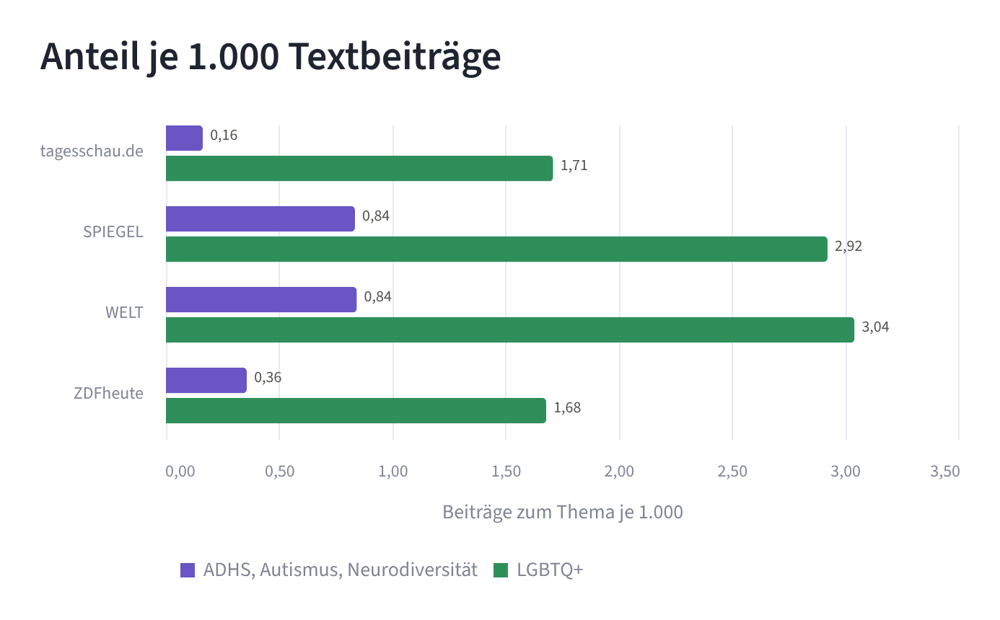
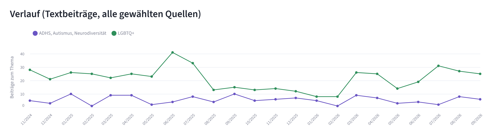
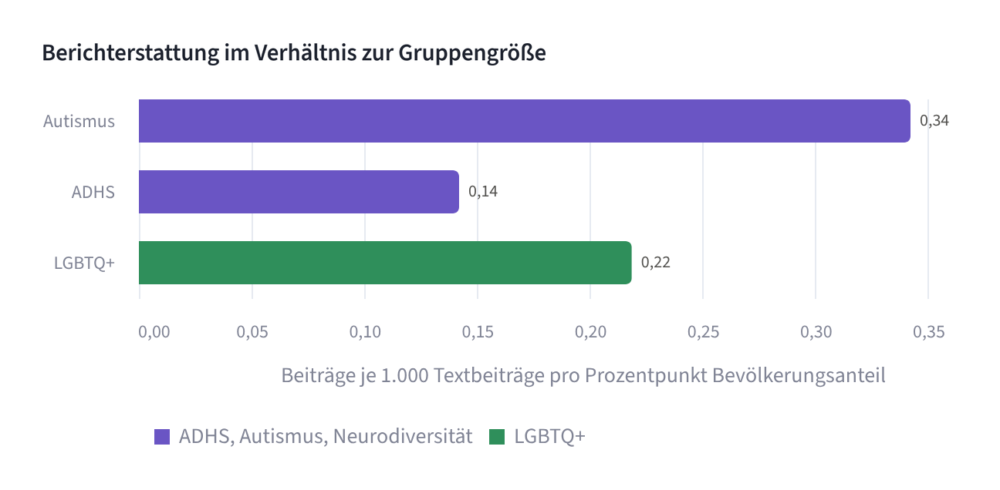

# ADHS, Autismus, Neurodiversität und LGBTQ+ auf deutschen Nachrichtenseiten, November 2024 bis September 2026

🇬🇧 [English version](README.md)

Dieses Projekt untersucht, wie oft große deutsche Nachrichtenseiten über zwei Gruppen berichten: über neurodivergente Menschen (ADHS, Autismus, Neurodiversität) und über queere Menschen (LGBTQ+). Gezählt wird jeder Beitrag, in dem einer der Begriffe in der Überschrift oder in der Dachzeile steht. Beide Gruppen werden auf dieselbe Weise ausgewertet und anschließend einander gegenübergestellt.

Ausgewertet wurden die Websites tagesschau.de, SPIEGEL, WELT und ZDFheute im Zeitraum vom 1. November 2024 bis zum 30. September 2026. Die Grundlage bilden 188.354 Textbeiträge. Die Daten wurden am 11. Oktober 2026 abgerufen.

## Interaktives Dashboard

**[Zum Dashboard](https://neurodiversity-lgbtq-german-news.streamlit.app/)**

Das Dashboard ist mit Streamlit gebaut und steht auf Deutsch und Englisch zur Verfügung. Die erste Seite zeigt die Auswertung zu ADHS, Autismus und Neurodiversität, die zweite die Auswertung zu LGBTQ+, die dritte den Vergleich der beiden Gruppen. Die vierte Seite zeigt, aus welchem Anlass über LGBTQ+ berichtet wird; Vorgehen und Ergebnisse dieser Auswertung stehen in einem [eigenen Dokument](EINORDNUNG.de.md). Quellen und Zeitraum lassen sich auf allen Seiten eingrenzen. Wie es sich auf dem eigenen Rechner starten lässt, steht im Abschnitt [Ausführen](#ausführen).

## Fragen und Ergebnisse

Sofern nicht anders angegeben, beziehen sich alle Zahlen auf Textbeiträge, in denen ein Begriff in der Überschrift oder in der Dachzeile vorkommt.

### 1. Wie oft berichten die vier Websites über ADHS, Autismus und Neurodiversität?

| Quelle | Alle Textbeiträge | Zum Thema | Je 1.000 Textbeiträge |
|---|---:|---:|---:|
| tagesschau.de | 24.549 | 4 | 0,16 |
| SPIEGEL | 69.442 | 58 | 0,84 |
| WELT | 66.394 | 56 | 0,84 |
| ZDFheute | 27.969 | 10 | 0,36 |
| **Gesamt** | **188.354** | **128** | **0,68** |

In 128 von 188.354 Textbeiträgen steht einer der Begriffe in der Überschrift oder in der Dachzeile. Das entspricht 0,07 Prozent oder durchschnittlich 5,6 Beiträgen im Monat auf allen vier Websites zusammen. Auf ADHS entfallen 69 Beiträge, auf Autismus 58 und auf Neurodiversität 11. Da ein Beitrag mehrere Begriffe enthalten kann, ist die Summe dieser drei Zahlen größer als die Zahl der Beiträge. Der Begriff „Asperger“ ist unter Autismus erfasst und steht selbst nur in einem Beitrag. Hinzu kommen 11 Videos, davon eines bei tagesschau.de, vier bei WELT und sechs bei ZDFheute.

### 2. Wie oft berichten die vier Websites über LGBTQ+?

| Quelle | Alle Textbeiträge | Zum Thema | Je 1.000 Textbeiträge |
|---|---:|---:|---:|
| tagesschau.de | 24.549 | 42 | 1,71 |
| SPIEGEL | 69.442 | 203 | 2,92 |
| WELT | 66.394 | 202 | 3,04 |
| ZDFheute | 27.969 | 47 | 1,68 |
| **Gesamt** | **188.354** | **494** | **2,62** |

In 494 von 188.354 Textbeiträgen steht einer der Begriffe in der Überschrift oder in der Dachzeile. Das entspricht 0,26 Prozent oder durchschnittlich 21,5 Beiträgen im Monat auf allen vier Websites zusammen. Die Begriffe „queer“ und „LGBTQ+“ stehen in 209 Fällen in der Überschrift oder in der Dachzeile, die Begriffe „schwul“, „lesbisch“, „homosexuell“ und „bisexuell“ in 132 Fällen und die Begriffe „trans“, „nichtbinär“ und „intergeschlechtlich“ in 186 Fällen. Jeder Begriff zählt je Beitrag höchstens einmal. Da ein Beitrag mehrere Begriffe enthalten kann, ist die Summe größer als die Zahl der Beiträge. Hinzu kommen 57 Videos, davon eines bei tagesschau.de, 33 bei WELT und 23 bei ZDFheute.

### 3. Wie unterscheiden sich die beiden Gruppen?

| Quelle | ADHS, Autismus, Neurodiversität | Je 1.000 | LGBTQ+ | Je 1.000 |
|---|---:|---:|---:|---:|
| tagesschau.de | 4 | 0,16 | 42 | 1,71 |
| SPIEGEL | 58 | 0,84 | 203 | 2,92 |
| WELT | 56 | 0,84 | 202 | 3,04 |
| ZDFheute | 10 | 0,36 | 47 | 1,68 |
| **Gesamt** | **128** | **0,68** | **494** | **2,62** |

Auf einen Textbeitrag zu ADHS, Autismus oder Neurodiversität kommen 3,9 Textbeiträge zu LGBTQ+. Dieses Verhältnis ist bei tagesschau.de am höchsten: Dort kommen auf einen Beitrag 10,5 Beiträge zu LGBTQ+ (4 gegenüber 42). Am niedrigsten ist es beim SPIEGEL mit 3,5 (58 gegenüber 203).





### 4. Wird „zu viel“ berichtet?

Häufig wird behauptet, LGBTQ+-Themen erhielten in den Medien übermäßig viel Aufmerksamkeit. Die Zahlen aus den Überschriften der vier untersuchten Nachrichtenseiten stützen diese Behauptung nicht: In 494 von 188.354 Textbeiträgen, also in 0,26 Prozent, wird die Gruppe in der Überschrift oder in der Dachzeile genannt. Zum Vergleich: In der Ipsos-Befragung bezeichneten sich 12 Prozent der Befragten zwischen 16 und 74 Jahren in Deutschland selbst als LGBT+ (2024 und 2025). Bei ADHS, Autismus und Neurodiversität liegt der Anteil der Beiträge bei 0,07 Prozent.

Beide Themen kommen demnach in deutlich weniger als einem Prozent aller Textbeiträge vor. Die 12 Prozent sind dabei kein Sollwert: Es wird nicht behauptet, dass 12 Prozent der Beiträge von LGBTQ+ handeln müssten. Der Vergleich zeigt nur die Größenordnung.

### 5. Wie verhält sich die Berichterstattung zur Größe der Gruppe?

Die Kennzahl setzt die Zahl der Beiträge ins Verhältnis zur Größe der Gruppe. Dazu wird die Zahl der Beiträge je 1.000 Textbeiträge durch den Anteil der Gruppe an der Bevölkerung in Prozent geteilt. Ein Beispiel: Auf Autismus entfallen 0,31 Beiträge je 1.000 Textbeiträge; geteilt durch den Bevölkerungsanteil von 0,90 Prozent ergibt das 0,34. Je höher der Wert ist, desto mehr wird im Verhältnis zur Größe der Gruppe berichtet. Für Neurodiversität als Sammelbegriff gibt es keinen Bevölkerungsanteil, deshalb steht sie nicht in der Tabelle.

| Gruppe | Anteil an der Bevölkerung | Textbeiträge | Je 1.000 | Je Prozentpunkt Bevölkerungsanteil |
|---|---:|---:|---:|---:|
| Autismus | 0,90 % (Westeuropa, Schätzung) | 58 | 0,31 | 0,34 |
| ADHS | 2,58 % (Erwachsene weltweit, Schätzung) | 69 | 0,37 | 0,14 |
| LGBTQ+ | 12 % (Deutschland, 16–74 Jahre, Selbstauskunft) | 494 | 2,62 | 0,22 |

Gemessen an der Größe der Gruppe wird über Autismus häufiger berichtet als über LGBTQ+ (0,34 gegenüber 0,22) und über ADHS seltener (0,14). Die Bevölkerungsanteile stammen allerdings aus unterschiedlichen Arten von Quellen, nämlich aus epidemiologischen Schätzungen und aus einer Befragung von 16- bis 74-Jährigen. Der Wert für ADHS bezieht sich auf Erwachsene, und die Gruppen können sich überschneiden. Die Kennzahl ist deshalb nur als grober Anhaltspunkt zu verstehen.



## Datenquellen

| Daten | Quelle | Vorgehen |
|---|---|---|
| Alle Beiträge und Überschriften | tagesschau.de, Archiv | vollständiges Archiv, jeder Beitrag des Zeitraums |
| Alle Beiträge und Überschriften | SPIEGEL, Nachrichtenarchiv | vollständiges Archiv, jeder Beitrag des Zeitraums |
| Alle Beiträge und Überschriften | WELT, Schlagzeilenarchiv | vollständiges Archiv, jeder Beitrag des Zeitraums |
| Beiträge zum Thema | ZDFheute, Suchfunktion | Volltextsuche; gewertet werden nur Überschrift und Dachzeile |
| Gesamtzahl der Textbeiträge | ZDFheute, öffentliche Sitemap | Textseiten nach dem Datum der letzten Änderung |

Die Bevölkerungsanteile stammen aus den folgenden Quellen:

| Zahl | Quelle |
|---|---|
| Autismus weltweit: 0,79 % | [WHO, Fact sheet „Autism“, 2025](https://www.who.int/news-room/fact-sheets/detail/autism-spectrum-disorders) |
| Autismus in Westeuropa: 0,90 % | [GBD 2021 Autism Spectrum Collaborators, The Lancet Psychiatry 2025](https://pmc.ncbi.nlm.nih.gov/articles/PMC11750762) |
| Autismus-Diagnose in Deutschland, 0–24 Jahre: 0,38 % (2012) | [Bachmann, Gerste, Hoffmann: Autism 22(3), 2018](https://doi.org/10.1177/1362361316673977) |
| ADHS-Diagnose in Deutschland, 3–17 Jahre: 4,4 % | [Göbel et al., Journal of Health Monitoring 2018 (RKI)](https://edoc.rki.de/handle/176904/5768) |
| ADHS bei Erwachsenen weltweit: 2,58 % | [S3-Leitlinie ADHS, AWMF 028-045](https://www.dgppn.de/_Resources/Persistent/352a63526561b8e26f497ee2ad5ef392dcaa69c7/028-045l_S3_KF_Aufmerksamkeitsdefizit-Hyperaktivit%C3%A4tsstoerung-ADHS-Kinder-Jugendliche-Erwachsene_205-05.pdf) |
| LGBT+ in Deutschland, 16–74 Jahre: 12 % (2024, 2025) | [Ipsos, „LGBT+ Pride 2024“](https://www.ipsos.com/de-de/studie-pride-month-lgbtqia-rechte-weltweit-unter-druck); [Ipsos, Pressemitteilung „LGBT+ Pride 2025“](https://www.csdmuenchen.de/files/presse_downloads/Ipsos-PM_LGBT-Pride_2025-06-10.pdf) |

Für ADHS, Autismus und Neurodiversität wurden die folgenden Begriffe gezählt: ADHS, Aufmerksamkeitsdefizit, Autismus und seine Ableitungen (Autist, autistisch, einschließlich gegenderter Schreibweisen), Asperger, Neurodiversität, neurodivergent und neurotypisch.

Für LGBTQ+ wurden die folgenden Begriffe gezählt: queer; LGBT und LSBT in allen Schreibweisen; schwul, lesbisch, homosexuell und bisexuell; trans als eigenes Wort sowie transgender, Transfrau, Transmann, transsexuell, transident, transfeindlich und vergleichbare Formen; nichtbinär und non-binär; intergeschlechtlich und intersexuell. Ereignisse und Symbole, die die Gruppe nicht benennen, wurden nicht gezählt. Dazu gehören der Christopher Street Day, Pride und die Regenbogenflagge.

Die veröffentlichten Datendateien enthalten ausschließlich Monatszahlen. Die Überschriften, die Listen der Beiträge und die zwischengespeicherten Archive der Websites werden nicht veröffentlicht.

## Projektstruktur

```
├── neurodiv_websites.py          erfasst und zählt die Beiträge
├── dashboard.py                  Streamlit-Dashboard (Deutsch / Englisch)
├── beitraege_einordnen.py        ordnet die LGBTQ+-Beiträge nach Anlass ein (Sprachmodell von OpenAI)
├── beitraege_einordnen_lokal.py  dieselbe Einordnung mit einem lokalen Modell (Ollama)
├── seiten_pruefen.py             Hilfsskript vom Projektbeginn: prüft den Aufbau der Websites
├── requirements.txt              Pakete für das Dashboard
├── .streamlit/config.toml        Farben des Dashboards
├── data/raw/
│   ├── monatszahlen.csv          Zahlen je Quelle und Monat: ADHS, Autismus, Neurodiversität
│   ├── monatszahlen_lgbtq.csv    Zahlen je Quelle und Monat: LGBTQ+
│   └── einordnung_lgbtq_*.csv    Zahlen zur Einordnung nach Anlass (drei Dateien)
├── images/                       Diagramme aus dem Dashboard für das README
├── EINORDNUNG.md / EINORDNUNG.de.md   Auswertung: Anlass der Berichterstattung über LGBTQ+
├── README.md
└── README.de.md
```

Mit `seiten_pruefen.py` wurde zu Beginn des Projekts geprüft, wie die Archive und die Suchfunktionen der Websites aufgebaut sind. Geprüft wurden dabei auch ZEIT und Deutschlandfunk, die nicht in die Auswertung eingegangen sind. Für die Auswertung und das Dashboard wird das Skript nicht benötigt.

## Ausführen

Das Dashboard wird so gestartet:

```
pip install streamlit altair pandas
streamlit run dashboard.py
```

Wer die Daten neu erheben möchte, benötigt zusätzlich:

```
pip install beautifulsoup4 playwright requests
playwright install chromium
python neurodiv_websites.py
```

Der erste Lauf ruft mehr als 1.700 Archivseiten ab und dauert entsprechend lange. Er kann jederzeit abgebrochen und neu gestartet werden, da bereits abgerufene Tage und Monate zwischengespeichert werden. Die Zahlen können sich ändern, wenn die Websites Beiträge ergänzen oder entfernen.

## Grenzen

- Gewertet werden nur die Überschrift und die Dachzeile. Ein Beitrag, der ein Thema behandelt, ohne den Begriff dort zu nennen, wird nicht gezählt.
- Die Website von ZDFheute reicht nur bis Mitte Oktober 2024 zurück. Der November 2024 ist deshalb der erste Monat, der für alle vier Quellen vollständig vorliegt.
- Für ZDFheute liegt kein Archiv vor. Die Beiträge wurden über die Suchfunktion der Website ermittelt, und die Gesamtzahl der Textbeiträge stammt aus der öffentlichen Sitemap. Gezählt wurden dort die Textseiten nach dem Datum der letzten Änderung, ohne Themenseiten und Bildergalerien.
- Bei der Suche zu LGBTQ+ auf ZDFheute lag die Zahl der geladenen Treffer bei mehreren Suchwörtern um einen Treffer unter der gemeldeten Zahl.
- Gezählt wird das Vorkommen eines Begriffs unabhängig vom inhaltlichen Zusammenhang. In drei der 139 Beiträge zu ADHS, Autismus und Neurodiversität (Text und Video) geht es nicht um betroffene Menschen: Zweimal wird der Begriff als Sprachbild verwendet, einmal geht es um ADHS bei Hunden. In mindestens vier der 551 Beiträge zu LGBTQ+ geht es um Tiere oder Pflanzen. Diese Beiträge wurden nicht herausgerechnet, und eine vollständige inhaltliche Durchsicht aller Beiträge ist nicht erfolgt.
- Führt eine Website einen Beitrag am selben Tag mit derselben Überschrift mehrfach, wird er einmal gezählt. Das betrifft 416 Einträge (tagesschau.de 8, SPIEGEL 165, WELT 243). In wenigen Fällen handelt es sich dabei um verschiedene Beiträge mit gleichlautender Überschrift. Die Zahl der Beiträge zum Thema ändert sich dadurch nicht.
- Bei Videos wurden die Überschrift, die Dachzeile und der Kurztext geprüft, nicht der gesprochene Inhalt. Bei tagesschau.de umfasst die Kategorie auch Audiobeiträge und Podcasts. Das Archiv des SPIEGEL weist keine eigenen Videoeinträge aus.
- Erfasst sind die Beiträge, die am 11. Oktober 2026 online verfügbar waren. Ob Beiträge in der Zwischenzeit entfernt wurden, lässt sich von außen nicht feststellen.
- Untersucht wurden vier Nachrichtenseiten. Über Fernsehen, Radio, soziale Medien und Werbung sagen die Zahlen nichts aus.

## Wie dieses Projekt entstanden ist

Die Fragestellung, die Quellen, den Zeitraum und die Begriffe habe ich festgelegt, und die Erhebung habe ich auf meinem eigenen Rechner durchgeführt. Der Code und die Texte sind mit Unterstützung von KI (Claude) entstanden. Wie ich mit KI arbeite, beschreibe ich im Repository [local-ai-workflow](https://github.com/Amirhouschang/local-ai-workflow).

## Rechte

© 2026 Amirhoushang Rahmannejad. Alle Rechte vorbehalten.

Code, Texte und Abbildungen dürfen angesehen und geprüft, aber nicht kopiert oder weiterverwendet werden. Rückmeldungen über Issues sind willkommen. Die Rechte an den Beiträgen und Überschriften liegen bei den jeweiligen Medien.
