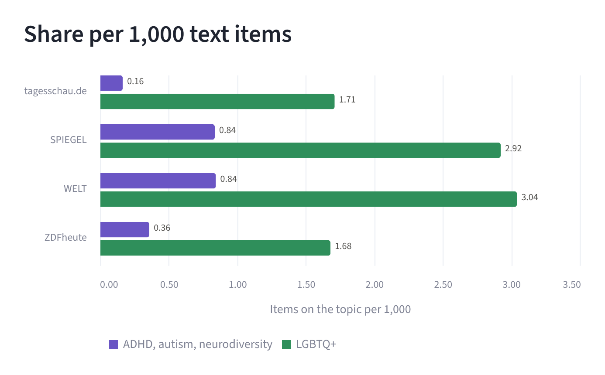
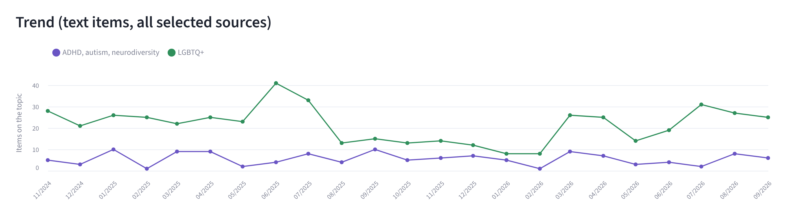
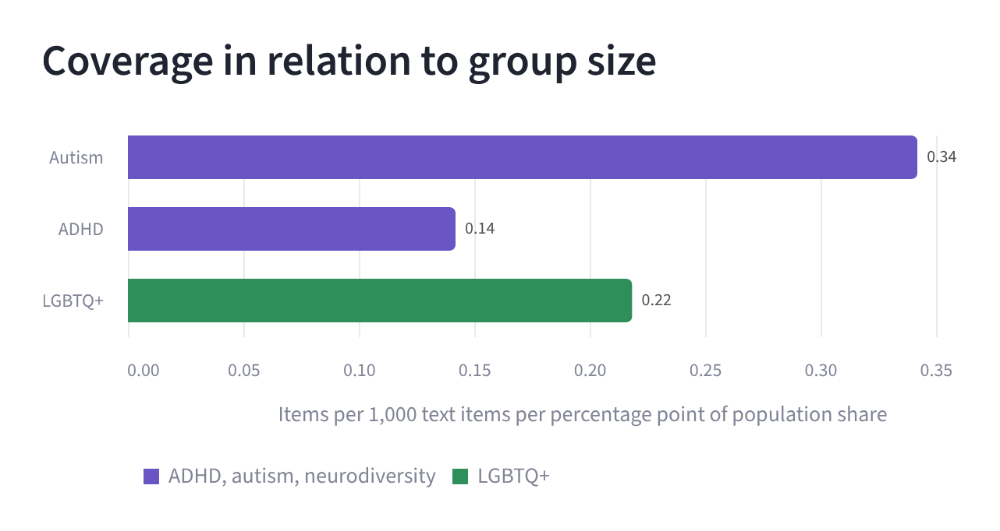

# ADHD, Autism, Neurodiversity and LGBTQ+ on German News Websites, November 2024 to September 2026

🇩🇪 [Deutsche Version](README.de.md)

This project examines how often large German news websites report on two groups: neurodivergent people (ADHD, autism, neurodiversity) and queer people (LGBTQ+). Every item is counted in which one of the terms appears in the headline or in the kicker. Both groups are analysed in the same way and then set side by side.

The analysis covers the websites tagesschau.de, SPIEGEL, WELT and ZDFheute in the period from 1 November 2024 to 30 September 2026. It is based on 188,354 text items. The data was retrieved on 11 October 2026.

## Interactive dashboard

**[Open the dashboard](https://neurodiversity-lgbtq-german-news.streamlit.app/)**

The dashboard is built with Streamlit and is available in German and English. The first page shows the analysis of ADHD, autism and neurodiversity, the second the analysis of LGBTQ+, and the third the comparison of the two groups. Sources and period can be narrowed down on all pages. The section [How to run](#how-to-run) explains how to start it on your own computer.

## Questions and findings

Unless stated otherwise, all figures refer to text items in which a term appears in the headline or in the kicker.

### 1. How often do the four websites report on ADHD, autism and neurodiversity?

| Source | All text items | On the topic | Per 1,000 text items |
|---|---:|---:|---:|
| tagesschau.de | 24,549 | 4 | 0.16 |
| SPIEGEL | 69,442 | 58 | 0.84 |
| WELT | 66,394 | 56 | 0.84 |
| ZDFheute | 27,969 | 10 | 0.36 |
| **Total** | **188,354** | **128** | **0.68** |

In 128 of 188,354 text items, one of the terms appears in the headline or in the kicker. This corresponds to 0.07 percent, or an average of 5.6 items per month across all four websites. ADHD accounts for 69 items, autism for 58 and neurodiversity for 11. As an item can contain several terms, the sum of these three figures is larger than the number of items. The term "Asperger" is counted under autism; the term itself appears in only one item. In addition there are 11 videos, one at tagesschau.de, four at WELT and six at ZDFheute.

### 2. How often do the four websites report on LGBTQ+?

| Source | All text items | On the topic | Per 1,000 text items |
|---|---:|---:|---:|
| tagesschau.de | 24,549 | 42 | 1.71 |
| SPIEGEL | 69,442 | 203 | 2.92 |
| WELT | 66,394 | 202 | 3.04 |
| ZDFheute | 27,969 | 47 | 1.68 |
| **Total** | **188,354** | **494** | **2.62** |

In 494 of 188,354 text items, one of the terms appears in the headline or in the kicker. This corresponds to 0.26 percent, or an average of 21.5 items per month across all four websites. The terms "queer" and "LGBTQ+" appear in the headline or in the kicker in 209 cases, the terms for gay, lesbian, homosexual and bisexual in 132 cases, and the terms for trans, non-binary and intersex in 186 cases. Each term is counted at most once per item. As an item can contain several terms, the sum is larger than the number of items. In addition there are 57 videos, one at tagesschau.de, 33 at WELT and 23 at ZDFheute.

### 3. How do the two groups compare?

| Source | ADHD, autism, neurodiversity | Per 1,000 | LGBTQ+ | Per 1,000 |
|---|---:|---:|---:|---:|
| tagesschau.de | 4 | 0.16 | 42 | 1.71 |
| SPIEGEL | 58 | 0.84 | 203 | 2.92 |
| WELT | 56 | 0.84 | 202 | 3.04 |
| ZDFheute | 10 | 0.36 | 47 | 1.68 |
| **Total** | **128** | **0.68** | **494** | **2.62** |

For every text item on ADHD, autism or neurodiversity there are 3.9 text items on LGBTQ+. This ratio is highest at tagesschau.de, where there are 10.5 items on LGBTQ+ for every item on ADHD, autism or neurodiversity (4 compared with 42). It is lowest at SPIEGEL, at 3.5 (58 compared with 203).





### 4. Is there "too much" coverage?

It is often claimed that LGBTQ+ topics receive excessive attention in the media. The figures from the headlines of the four news websites examined do not support this claim: the group is named in the headline or in the kicker of 494 of 188,354 text items, which is 0.26 percent. For comparison, in the Ipsos survey 12 percent of respondents aged 16 to 74 in Germany described themselves as LGBT+ (2024 and 2025). For ADHD, autism and neurodiversity, the share of items is 0.07 percent.

Both topics therefore appear in well under one percent of all text items. The 12 percent is not a target value: it is not claimed that 12 percent of items ought to deal with LGBTQ+. The comparison only shows the order of magnitude.

### 5. How does coverage relate to the size of the group?

The indicator relates the number of items to the size of the group. For this purpose, the number of items per 1,000 text items is divided by the group's share of the population in percent. An example: autism accounts for 0.31 items per 1,000 text items; divided by the population share of 0.90 percent, this gives 0.34. The higher the value, the more coverage there is in relation to the size of the group. No population share exists for neurodiversity as an umbrella term, which is why it is not included in the table.

| Group | Share of the population | Text items | Per 1,000 | Per percentage point of population share |
|---|---:|---:|---:|---:|
| Autism | 0.90% (Western Europe, estimate) | 58 | 0.31 | 0.34 |
| ADHD | 2.58% (adults worldwide, estimate) | 69 | 0.37 | 0.14 |
| LGBTQ+ | 12% (Germany, ages 16–74, self-reported) | 494 | 2.62 | 0.22 |

Measured against the size of the group, autism is covered more often than LGBTQ+ (0.34 compared with 0.22) and ADHD less often (0.14). However, the population shares come from different kinds of sources, namely epidemiological estimates and a survey of people aged 16 to 74. The value for ADHD refers to adults, and the groups may overlap. The indicator should therefore be understood as a rough guide only.



## Data sources

| Data | Source | Method |
|---|---|---|
| All items and headlines | tagesschau.de, archive | complete archive, every item of the period |
| All items and headlines | SPIEGEL, news archive | complete archive, every item of the period |
| All items and headlines | WELT, headline archive | complete archive, every item of the period |
| Items on the topic | ZDFheute, search function | full-text search; only headline and kicker are counted |
| Total number of text items | ZDFheute, public sitemap | text pages by date of last modification |

The population shares are taken from the following sources:

| Figure | Source |
|---|---|
| Autism worldwide: 0.79% | [WHO, fact sheet "Autism", 2025](https://www.who.int/news-room/fact-sheets/detail/autism-spectrum-disorders) |
| Autism in Western Europe: 0.90% | [GBD 2021 Autism Spectrum Collaborators, The Lancet Psychiatry 2025](https://pmc.ncbi.nlm.nih.gov/articles/PMC11750762) |
| Autism diagnosis in Germany, ages 0–24: 0.38% (2012) | [Bachmann, Gerste, Hoffmann: Autism 22(3), 2018](https://doi.org/10.1177/1362361316673977) |
| ADHD diagnosis in Germany, ages 3–17: 4.4% | [Göbel et al., Journal of Health Monitoring 2018 (RKI)](https://edoc.rki.de/handle/176904/5768) |
| ADHD in adults worldwide: 2.58% | [S3 guideline ADHD, AWMF 028-045](https://www.dgppn.de/_Resources/Persistent/352a63526561b8e26f497ee2ad5ef392dcaa69c7/028-045l_S3_KF_Aufmerksamkeitsdefizit-Hyperaktivit%C3%A4tsstoerung-ADHS-Kinder-Jugendliche-Erwachsene_205-05.pdf) |
| LGBT+ in Germany, ages 16–74: 12% (2024, 2025) | [Ipsos, "LGBT+ Pride 2024"](https://www.ipsos.com/de-de/studie-pride-month-lgbtqia-rechte-weltweit-unter-druck); [Ipsos, press release "LGBT+ Pride 2025"](https://www.csdmuenchen.de/files/presse_downloads/Ipsos-PM_LGBT-Pride_2025-06-10.pdf) |

For ADHD, autism and neurodiversity, the following German terms were counted: ADHS, Aufmerksamkeitsdefizit, Autismus and its derived forms (Autist, autistisch, including gender-inclusive spellings), Asperger, Neurodiversität, neurodivergent and neurotypisch.

For LGBTQ+, the following German terms were counted: queer; LGBT and LSBT in all spellings; schwul, lesbisch, homosexuell and bisexuell; trans as a separate word as well as transgender, Transfrau, Transmann, transsexuell, transident, transfeindlich and comparable forms; nichtbinär and non-binär; intergeschlechtlich and intersexuell. Events and symbols that do not name the group were not counted. These include Christopher Street Day, Pride and the rainbow flag.

The published data files contain monthly figures only. The headlines, the lists of items and the cached archives of the websites are not published.

## Project structure

```
├── neurodiv_websites.py          collects and counts the items
├── dashboard.py                  Streamlit dashboard (German / English)
├── seiten_pruefen.py             helper script from the start of the project: checks how the websites are structured
├── requirements.txt              packages for the dashboard
├── .streamlit/config.toml        colours of the dashboard
├── data/raw/
│   ├── monatszahlen.csv          figures per source and month: ADHD, autism, neurodiversity
│   └── monatszahlen_lgbtq.csv    figures per source and month: LGBTQ+
├── images/                       charts from the dashboard for the README
├── README.md
└── README.de.md
```

At the start of the project, `seiten_pruefen.py` was used to check how the archives and search functions of the websites are structured. ZEIT and Deutschlandfunk were also checked at that stage; they were not included in the analysis. The script is not needed for the analysis or the dashboard.

## How to run

The dashboard is started as follows:

```
pip install streamlit altair pandas
streamlit run dashboard.py
```

Collecting the data again additionally requires:

```
pip install beautifulsoup4 playwright requests
playwright install chromium
python neurodiv_websites.py
```

The first run retrieves more than 1,700 archive pages and takes a correspondingly long time. It can be interrupted and restarted at any time, as days and months already retrieved are cached. The figures can change if the websites add or remove items.

## Limitations

- Only the headline and the kicker are counted. An item that deals with a topic without naming the term there is not counted.
- The ZDFheute website only reaches back to mid-October 2024. November 2024 is therefore the first month available in full for all four sources.
- No archive is available for ZDFheute. The items were identified via the website's search function, and the total number of text items comes from the public sitemap. There, text pages were counted by date of last modification, excluding topic pages and picture galleries.
- In the LGBTQ+ search on ZDFheute, the number of results loaded was one below the number reported for several search words.
- An occurrence is counted irrespective of context. In three of the 139 items on ADHD, autism and neurodiversity (text and video), the piece is not about people affected: twice the term is used as a figure of speech, and once the subject is ADHD in dogs. In at least four of the 551 items on LGBTQ+, the piece is about animals or plants. These items were not excluded, and the content of all items has not been reviewed in full.
- If a website lists an item several times on the same day with the same headline, it is counted once. This applies to 416 entries (tagesschau.de 8, SPIEGEL 165, WELT 243). In a few cases these are different items with identical headlines. The number of items on the topic is not affected.
- For videos, the headline, the kicker and the teaser text were examined, not the spoken content. For tagesschau.de the category also includes audio items and podcasts. The SPIEGEL archive does not list separate video items.
- The data covers items that were available online on 11 October 2026. Whether items have been removed in the meantime cannot be determined from outside.
- Four news websites were examined. The figures say nothing about television, radio, social media or advertising.

## How this project was made

I defined the research question, the sources, the period and the terms, and I carried out the data collection on my own computer. The code and the texts were written with the support of AI (Claude). I describe how I work with AI in the repository [local-ai-workflow](https://github.com/Amirhouschang/local-ai-workflow).

## Rights

© 2026 Amirhoushang Rahmannejad. All rights reserved.

Code, texts and figures may be viewed and reviewed, but not copied or reused. Feedback via issues is welcome. The rights to the items and headlines remain with the respective media.
